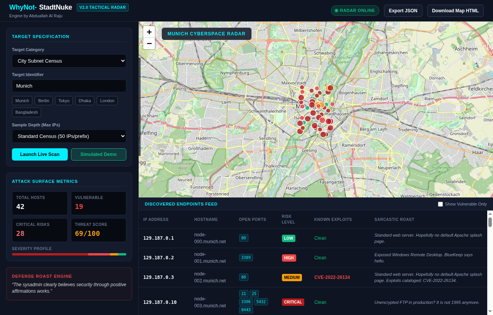

<!--
SEO Metadata & Indexing Information
Primary Keywords: network census, attack surface management, OSINT reconnaissance, Shodan InternetDB, port scanner, network security steganography, Folium Leaflet mapping, cybersecurity telemetry, vulnerability scanner, CVE assessment
Author: Abduallah Al Raju
Repository: https://github.com/Abdullah-Al-Raju/WhyNot-StadtNuke
-->

# WhyNot-StadtNuke

**A High-Performance Network Attack-Surface Census and Geospatial Intelligence Framework**

[](https://www.python.org/downloads/)
[](https://opensource.org/licenses/MIT)
[](https://github.com/Abdullah-Al-Raju/WhyNot-StadtNuke)
[](https://github.com/Abdullah-Al-Raju/WhyNot-StadtNuke)
[](https://github.com/Abdullah-Al-Raju/WhyNot-StadtNuke)

WhyNot-StadtNuke is a network attack-surface discovery and reconnaissance suite that surveys municipal, national, or enterprise IP allocations without requiring expensive Shodan API subscription tiers. Operating through asynchronous queries against Shodan's free InternetDB API and local routing registries, it discovers active internet-connected hosts, maps exposed services and cataloged CVE vulnerabilities, and renders interactive geospatial intelligence maps.

Designed and developed by **Abduallah Al Raju**, this framework serves as an automated attack-surface profiling engine for Security Operations Center (SOC) analysts, penetration testers, and security researchers evaluating municipal and regional cyber hygiene.

---

## Tactical Web Radar & Visual Dashboard



WhyNot-StadtNuke includes an interactive web radar operating on FastAPI and WebSockets, rendering live endpoint telemetry, threat score meters, and interactive Leaflet maps:

```bash
python3 stadtnuke.py web --port 8080 --host 127.0.0.1
```

Access the visual dashboard at `http://127.0.0.1:8080` in any modern web browser.

### Web Radar Capabilities

- **Real-Time Endpoint Streaming**: Streams newly surveyed devices directly into the UI over WebSockets as queries complete.
- **Interactive OpenStreetMap Radar**: Plots live color-coded markers (Critical, High, Medium, Low) centered over the target city or country.
- **Attack Surface Telemetry Counter**: Tracks surveyed hosts, vulnerable nodes, critical port exposures, and calculates a normalized Threat Score (0 to 100).
- **Defense Roast Engine**: Analyzes exposed service configurations and generates empirical, sarcastic security audit feedback.
- **Export Pipeline**: Generates standalone Folium HTML maps and exports structured JSON datasets with one click.

---

## System Architecture

```
User CLI / Tactical Web UI
         |
    stadtnuke.py (Unified Controller)
         |
    stadtnuke_core.py (Census Engine)
    +-----------------------------------------------+
    | 1. Target Resolver (data/subnets.json + RIPE) |
    | 2. Stratified Host Sampler (Subnet Boundary)  |
    | 3. Async InternetDB Worker Pool               |
    | 4. Risk Scorer (data/ports.json + CVEs)       |
    | 5. Offline Simulation Engine                  |
    +-----------------------------------------------+
         |
    stadtnuke_map.py (Geospatial Clustering Engine)
         |
    Output Artifacts: HTML Map, JSON Dataset, Sarcastic Audit
```

---

## Key Technical Features

### 1. Offline Subnet Intelligence
The framework includes a built-in subnet database (`data/subnets.json`) covering 100+ major global metropolitan areas (Munich, Berlin, Frankfurt, Tokyo, London, Paris, New York, Dhaka, Singapore, Sydney, etc.) and country-level IP prefixes. It eliminates dependency on flaky external routing APIs while maintaining fallback resolution.

### 2. Stratified Host Sampling
Rather than inefficient sequential scanning of contiguous IP addresses (e.g. `.1` to `.50`), the engine applies stratified sampling and gateway boundary probing across entire `/16`, `/20`, or `/22` blocks to maximize discovery density across enterprise and municipal networks.

### 3. Asynchronous Concurrent Engine
Multi-threaded worker pool querying Shodan InternetDB with token-bucket pacing and connection pooling, surveying hundreds of candidate IP endpoints in seconds without tripping rate-limiting blocks.

### 4. Zero-Key Geospatial Mapping
Generates standalone HTML maps using Folium and Leaflet `MarkerCluster` with OpenStreetMap base layers, completely independent of commercial tile API keys. Duplicate geographic coordinates receive micro-jitter offsets ($\pm 150$ meters) to prevent stacked markers without altering true municipal placement.

### 5. Sarcastic Defense Audit Roaster
Calculates threat scores based on exposed sensitive ports (Telnet 23, SMB 445, ADB 5555, Redis 6379, DICOM 104, SCADA Modbus 502, RTSP 554) and active CVE vulnerabilities, outputting actionable security analysis wrapped in dry technical satire.

### 6. Zero-Network Simulation Mode
Includes a built-in synthetic census engine (`stadtnuke.py demo`) that generates mathematically accurate host distributions, CVE catalogs, and port exposures for air-gapped environments, CI pipelines, and live demonstrations.

---

## Command-Line Reference

WhyNot-StadtNuke features a unified CLI entrypoint via `stadtnuke.py`:

```
usage: stadtnuke.py [-h] {scan,demo,map,merge,report,web} ...
```

### 1. Network Census Scan

```bash
# Scan a city using built-in subnet database
python3 stadtnuke.py scan --city "Munich" --max-ips 50 --map

# Scan an entire country allocation
python3 stadtnuke.py scan --country "BD" --max-ips 30 --map

# Scan a specific Autonomous System (ISP/Telco)
python3 stadtnuke.py scan --asn "AS45609" --map

# Scan a direct CIDR subnet prefix
python3 stadtnuke.py scan --cidr "129.187.0.0/16" --map
```

### 2. Offline Simulation Demo

```bash
# Generate simulated census with interactive map (zero network required)
python3 stadtnuke.py demo --city "Munich" --count 40 --vuln-ratio 0.35
```

### 3. Geospatial Map Generation

```bash
# Render map from an existing JSON scan
python3 stadtnuke.py map --input munich_stadtnuke.json --output munich_map.html
```

### 4. Global Map Merger

```bash
# Merge multiple regional scans into one global world map
python3 stadtnuke.py merge munich_stadtnuke.json tokyo_stadtnuke.json --output GLOBAL_MAP.html
```

### 5. Sarcastic Defense Report

```bash
# Print detailed technical audit and sarcastic assessment
python3 stadtnuke.py report munich_stadtnuke.json
```

### 6. Tactical Web Dashboard

```bash
# Start local web radar
python3 stadtnuke.py web --port 8080 --host 127.0.0.1
```

---

## Legacy Script Compatibility

For existing workflows and backward compatibility, all original scripts have been refactored into thin wrappers routing directly to the core engine:

| Legacy Script | Description | Unified Equivalent |
|---|---|---|
| `stadtnuke.py` | Core city scanner | `python3 stadtnuke.py scan --city Munich` |
| `stadtnuke_ultimate.py` | Dynamic city scanner | `python3 stadtnuke.py scan --city <City>` |
| `stadtnuke_worldwide.py` | Country / ASN scanner | `python3 stadtnuke.py scan --country <Code>` |
| `make_map.py` | Munich map generator | `python3 stadtnuke.py map --input Munich_stadtnuke.json` |
| `make_map_ultimate.py` | Custom city map generator | `python3 stadtnuke.py map --input <File>` |
| `map_worldwide.py` | Country map generator | `python3 stadtnuke.py map --input <File>` |
| `merge_all_maps.py` | Global world map merger | `python3 stadtnuke.py merge *.json` |

---

## Project Structure

```
WhyNot-StadtNuke/
├── stadtnuke.py              # Master CLI entrypoint
├── stadtnuke_core.py         # Subnet resolution, sampling, scanning & risk scoring
├── stadtnuke_map.py          # Folium & Leaflet geospatial clustering engine
├── web_app.py                # FastAPI backend with REST API & WebSocket streaming
├── web/                      # Tactical web radar single-page application
│   ├── index.html            # Web dashboard interface
│   ├── style.css             # Tactical dark-cyberpunk stylesheet
│   └── app.js                # Leaflet map controller & WebSocket client
├── data/                     # Offline intelligence registries
│   ├── subnets.json          # 100+ cities and country IP allocations
│   └── ports.json            # Sensitive port signatures, weights & roast templates
├── tests/                    # Automated pytest test suite
│   └── test_stadtnuke.py     # 16 unit and integration test specifications
├── pyproject.toml            # PEP 517/621 packaging metadata
├── .github/workflows/ci.yml  # Automated CI/CD testing pipeline
├── README.md                 # Technical framework documentation
└── VERIFICATION_REPORT.md    # Empirical test logs & validation telemetry
```

---

## Installation & Setup

### Requirements
- Python 3.9+
- Linux (Debian, Ubuntu, Kali, Arch), macOS, or Windows

### Setup

```bash
git clone https://github.com/Abdullah-Al-Raju/WhyNot-StadtNuke.git
cd WhyNot-StadtNuke
python3 -m pip install -e .
```

To run the automated test suite:

```bash
pytest -v tests/
```

---

## Author & Attribution

Designed and engineered by:

**Abduallah Al Raju**  
*Network Engineer, Systems Integrator & Security Analyst*  
GitHub: [https://github.com/Abdullah-Al-Raju](https://github.com/Abdullah-Al-Raju)  
Profile Repository: [https://github.com/Abdullah-Al-Raju/Abdullah-Al-Raju](https://github.com/Abdullah-Al-Raju/Abdullah-Al-Raju)

---

## License

This project is licensed under the MIT License. See [License](License) for details.
